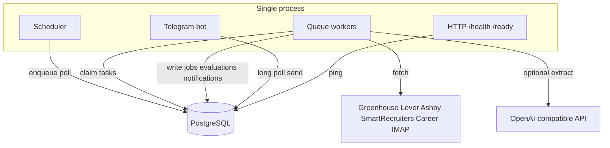

# Architecture

RoleRadar is one long-running Go process backed by PostgreSQL. It does not split into separate microservices.

## End-to-end flow

1. **Startup** — Load config, run migrations (with a DB lock), upsert `SOURCES` into `job_sources`, open the pool.
2. **Schedule** — Every 30 seconds, enqueue `poll` tasks for enabled sources whose interval plus jitter has elapsed.
3. **Worker claim** — A worker claims one queue task, runs the handler with `TASK_TIMEOUT`, then completes, retries, or fails the task.
4. **Poll** — Adapter fetches a board, career JSON, or mailbox. `pipeline.Apply` upserts jobs and enqueues `match` tasks for new or changed full postings.
5. **Match** — Load job and active profile. Optionally call the LLM extractor when `LLM_API_KEY` is set and the description is long enough. Score with weighted rules. Insert evaluation and a notification when the score meets `MATCH_THRESHOLD`.
6. **Telegram delivery** — Long polling receives commands and replies. A loop sends pending preview and evaluated messages to `TELEGRAM_USER_ID`.
7. **Feedback** — Inline buttons or `/feedback` store a label. Labels do not change weights.

## Components

| Component | Package | Role |
| --- | --- | --- |
| Scheduler | `internal/schedule` | Enqueues poll tasks; does not HTTP |
| Queue worker | `internal/worker` | Claims tasks, recovers expired locks |
| Source adapters | `internal/source` | Board APIs, career JSON, IMAP, URL allowlist for `/add` |
| Pipeline | `internal/pipeline` | Apply snapshots, mail, and match tasks |
| Rules | `internal/match` | Weighted scoring and threshold |
| Extractor | `internal/extract` | Optional fact JSON from posting text |
| Telegram | `internal/notify` | Delivery, commands, feedback |
| Store | `internal/store` | SQL, migrations, queue semantics |
| Health | `internal/health` | Liveness without DB; readiness with DB ping |

## Task types

- **`poll`** — One enabled source. Failure is recorded on the source run; incomplete snapshots do not close jobs.
- **`match`** — One job hash and profile version. Deduped by evaluation cache key.

## Single-process rule

Run exactly one app instance against one database. A second instance schedules duplicate polls and can race on Telegram delivery. Compose runs one `app` service by design.

## Data the process stores

Jobs, source references, raw mailbox messages, evaluations, extractions, notifications, feedback, profiles, queue tasks, and extractor token usage per UTC day. Logs are JSON on stdout and exclude secrets and posting bodies.